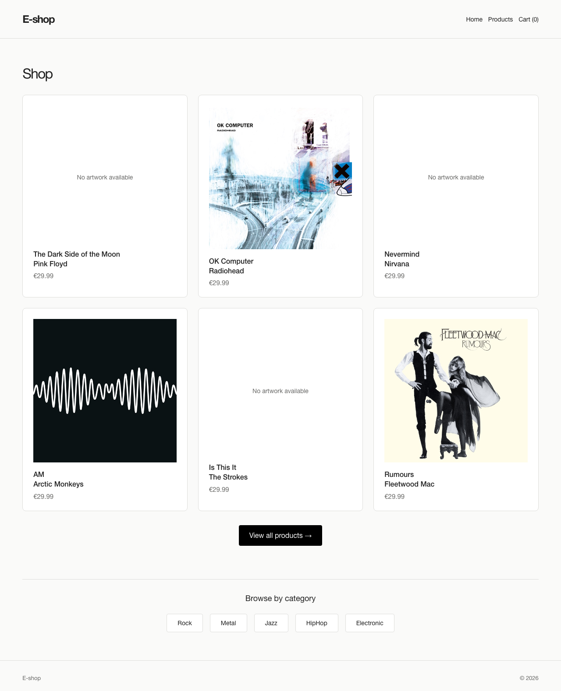
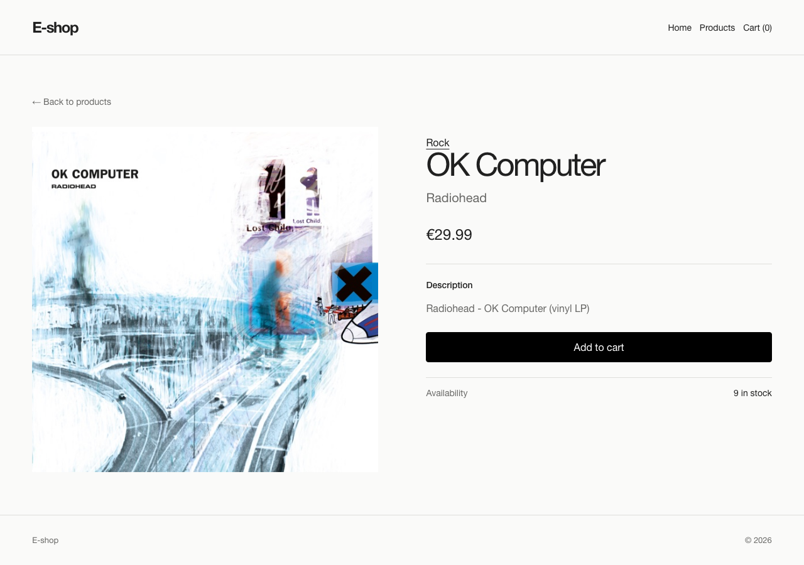
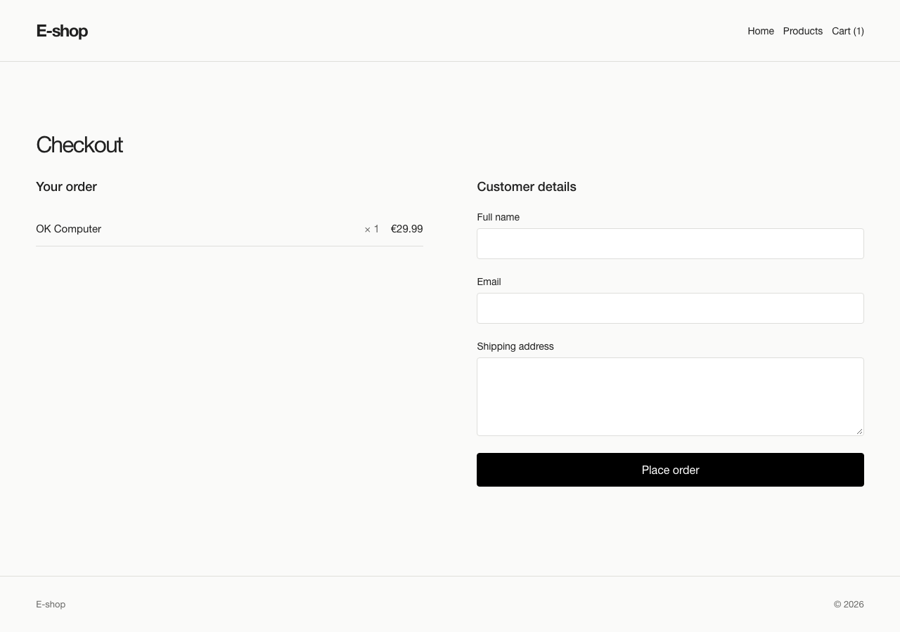

# EShopClient

A small online vinyl record shop built with React. This is the frontend for EShopApi, an ASP.NET Core backend that provides the products and saves orders.

You can browse records, filter them by music category, sort by price, and open a record to see its description and stock. From there, you can add it to your cart, change the quantity, and place an order through checkout.

The app shows a confirmation page after a successful order and displays API error messages when something goes wrong. Records without a cover show “No artwork available”.

## Screenshots

The home page, with products from the API:



A record's details and availability:



Checkout, with the order summary and customer details form:



## Run locally

You'll need Node.js 22.12 or newer, npm, and a running EShopApi backend.

Install the dependencies:

```sh
npm install
```

Create a `.env` file in the project root:

```env
VITE_API_BASE_URL=http://localhost:5000/api
```

Replace the example address with your backend's URL, keeping the `/api` part.

Start the app:

```sh
npm run dev
```

Open the local URL printed in the terminal.

## Built with

React, React Router, and Vite. API requests use the browser's `fetch` function.

The page components are in `src/pages`, shared components are in `src/components`, and API calls are in `src/api`.

## Current limits

The cart is stored in memory, so refreshing the page clears it. Checkout creates an order, but there is no online payment or user login yet.

## Other commands

```sh
npm run lint     # Check the code
npm run build    # Create the production build
npm run preview  # Preview the production build locally
```
